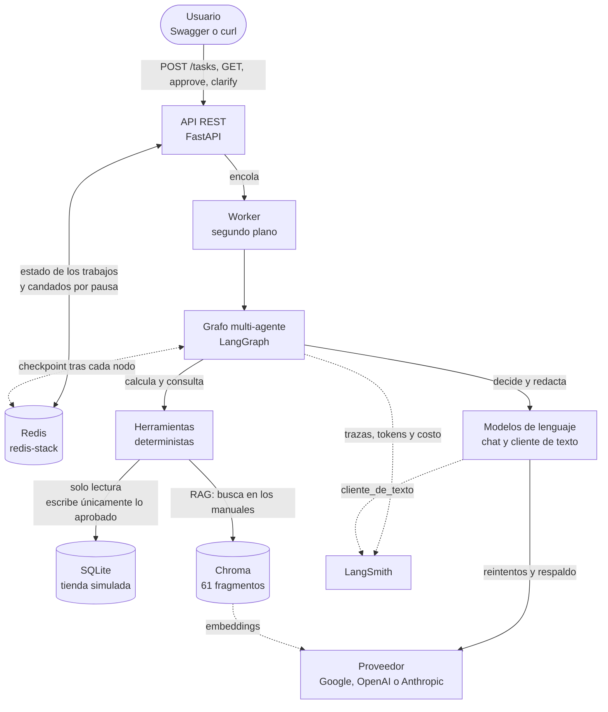
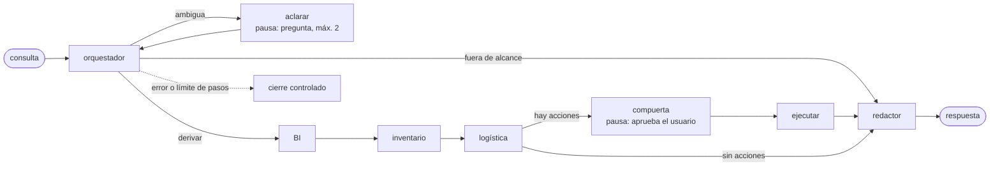
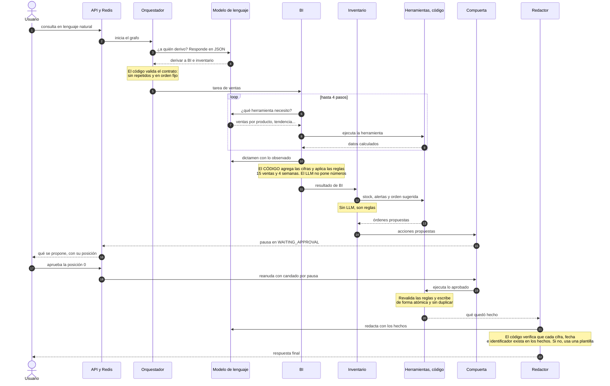
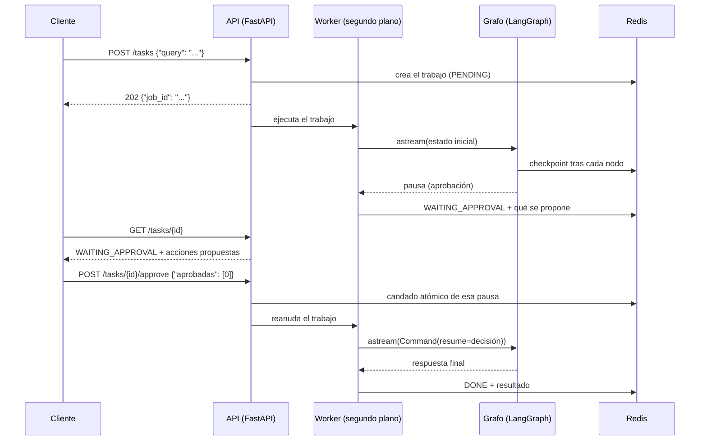
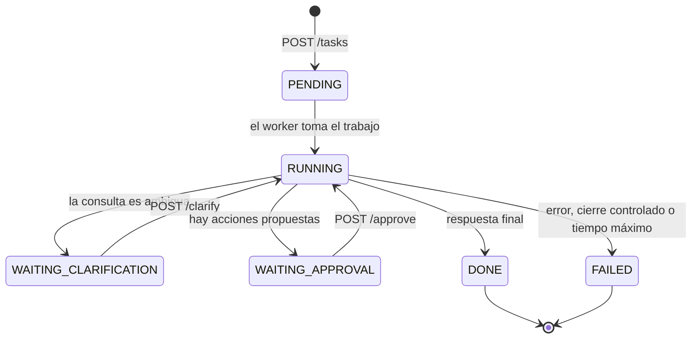

# Agente de back office para un e-commerce de moda

Un sistema **multi-agente** (LangGraph) que ayuda a la dueña de una tienda online de carteras a responder preguntas de
**ventas, inventario y pedidos** y a ejecutar acciones de negocio (órdenes de compra, avisos a clientes, compensaciones,
cancelaciones) **solo después de que ella las aprueba**. Se opera por una **API REST asíncrona**, el estado vive en **Redis**,
las decisiones se apoyan en **manuales de la tienda recuperados por RAG** y cada ejecución queda **trazada en LangSmith**.

Los datos son simulados (una tienda ficticia de carteras con estética Y2K); el diseño está pensado para conectarlo después
a una tienda real. Todo el código, los prompts, los comentarios y la documentación están en español.

> **Principio rector.** El LLM decide y redacta; **el código calcula y valida**. Ninguna cifra, fecha, compensación ni acción
> con efecto la inventa un modelo: salen de herramientas deterministas, y todo lo que el LLM produce se valida contra un contrato
> antes de usarse. Casi todas las decisiones de diseño de este proyecto son consecuencias de ese principio.

## Vista de un vistazo

Cómo se conectan las piezas. Las flechas continuas son el flujo principal y las punteadas, lo que ocurre en segundo plano.



**Cómo leerlo:** el **grafo** coordina a los agentes; los **modelos de lenguaje** solo deciden y redactan; las **herramientas deterministas** calculan todo lo que es cifra, fecha o regla de negocio y son lo único que toca los datos; **Redis** guarda el estado para que una consulta pausada sobreviva a un reinicio; y **LangSmith** registra cada ejecución.
Los detalles de cada flujo están en la [sección 3](#3-arquitectura).

## Contenido

0. [Vista de un vistazo](#vista-de-un-vistazo)
1. [Cómo cumple los requisitos del curso](#1-cómo-cumple-los-requisitos-del-curso)
2. [Qué hace, con un ejemplo](#2-qué-hace-con-un-ejemplo)
3. [Arquitectura](#3-arquitectura)
4. [Los agentes](#4-los-agentes)
5. [Las herramientas](#5-las-herramientas)
6. [Datos simulados](#6-datos-simulados)
7. [RAG: los manuales de la tienda](#7-rag-los-manuales-de-la-tienda)
8. [La API](#8-la-api)
9. [Persistencia con Redis](#9-persistencia-con-redis)
10. [Observabilidad](#10-observabilidad)
11. [Resiliencia y manejo de errores](#11-resiliencia-y-manejo-de-errores)
12. [Configuración](#12-configuración)
13. [Cómo ejecutarlo](#13-cómo-ejecutarlo)
14. [Pruebas](#14-pruebas)
15. [Evidencias](#15-evidencias)
16. [Decisiones de diseño](#16-decisiones-de-diseño)
17. [Limitaciones conocidas y trabajo futuro](#17-limitaciones-conocidas-y-trabajo-futuro)
18. [Estructura del repositorio](#18-estructura-del-repositorio)

---

## 1. Cómo cumple los requisitos del curso

Cada fila indica **dónde está** la implementación y **cómo verificarla** sin leer todo el código.

| Requisito | Qué se hizo | Dónde | Cómo verificarlo |
|---|---|---|---|
| **RAG** | Tres manuales de la tienda, cortados por estructura (61 fragmentos con metadatos), en Chroma con distancia coseno. Búsqueda vectorial, BM25 e híbrida (RRF). Evaluación con 47 preguntas | `app/rag/`, `data/docs_rag/`, `data/eval/` | `python -m scripts.eval_rag --solo-bm25` (sin claves); `pytest tests/test_rag_*.py` |
| **Razonamiento multi-paso** | Un orquestador reparte la consulta entre especialistas en orden fijo. BI es un agente con bucle de herramientas (máximo 4 pasos). Inventario y Logística son flujos de pasos fijos | `app/graph.py`, `app/agents/` | `pytest tests/test_grafo.py tests/test_agentes.py`; `docs/grafo.mmd` |
| **API asíncrona** | FastAPI con el patrón *ticket y consulta*: `POST /tasks` responde `202` al instante; un worker ejecuta el grafo en segundo plano | `app/api/` | `pytest tests/test_api.py`; `python -m scripts.load_test` |
| **Estado persistente (Redis)** | Estado de los trabajos en Redis y checkpointer de LangGraph sobre Redis: una consulta pausada sobrevive a un reinicio de la API | `app/api/jobs.py`, `app/api/main.py` | `docker-compose.yml`; prueba T10 de `docs/plan-de-ejecucion.md` |
| **Aprobación humana (HITL)** | Dos tipos de pausa (`interrupt`): aclaración y aprobación. Se aprueba por posición, con candado atómico por pausa | `app/graph.py`, `app/api/hitl.py` | `pytest tests/test_grafo.py tests/test_api.py` |
| **Trazabilidad** | LangSmith: trazas raíz con `job_id`, tokens y costo. El cliente de texto (que no pasa por LangChain) está decorado para aparecer también | `app/observability.py`, `app/clients/base.py` | `pytest tests/test_observability.py tests/test_clients.py`; `python -m scripts.latency_report` |
| **Sin nombres de modelo ni IDs en el código** | Modelo, proveedor y claves salen solo del `.env`. Una prueba automática falla si aparece un nombre de modelo escrito en `app/` | `app/config.py` | `pytest tests/test_config_llm.py` |
| **Documentación para ingeniería senior** | Este README, el registro de decisiones con sus motivos, el avance por iteración y una guía de ejecución paso a paso | `docs/` | `docs/decisiones.md`, `docs/iteraciones.md`, `docs/plan-de-ejecucion.md` |
| **Cliente de modelos abstracto y asíncrono** | Cliente unificado para Google, OpenAI y Anthropic con errores tipados, reintentos, tiempo máximo, modelo de respaldo y medición de latencia | `app/clients/` | `pytest tests/test_clients.py tests/test_resiliencia.py` |
| **Arranque con un solo comando** | `docker compose up --build` levanta Redis, prepara lo que falte (base simulada y RAG) y arranca la API. Es idempotente: la segunda vez arranca en segundos | `scripts/arrancar.py`, `Dockerfile`, `docker-compose.yml` | `pytest tests/test_arranque.py`; sección 13 |
| **Pruebas automáticas** | 364 pruebas que no necesitan claves ni internet (modelos y Redis simulados) | `tests/` | `pytest` |

---

## 2. Qué hace, con un ejemplo

La dueña escribe, en lenguaje natural:

> *«¿Cuántas ventas tuvimos la última semana y qué cartera deberíamos ordenar pronto según la tendencia de ventas?»*

1. El **orquestador** decide que hacen falta dos especialistas: **BI** (ventas) e **Inventario** (qué ordenar).
2. **BI** consulta las ventas de la semana y la tendencia por producto, y dictamina.
3. **Inventario** calcula la cobertura de cada producto (stock dividido por ventas diarias) y propone órdenes de compra donde el stock
   no alcanza para el tiempo de reposición del proveedor (10 días).
4. Las órdenes quedan como **propuestas** y el sistema se **pausa** (`WAITING_APPROVAL`). Nada se escribió todavía.
5. La dueña aprueba **una parte** (por ejemplo, solo la primera orden).
6. Se ejecuta **solo lo aprobado**, y antes de escribir cada acción se **vuelve a comprobar** que las reglas todavía la recomiendan.
7. El **redactor** responde con las cifras reales y lo que quedó registrado.

Si la consulta es ambigua (*«¿Cómo vamos?»*), el sistema **pregunta** (máximo 2 veces). Si no tiene que ver con la tienda
(*«¿Qué tiempo hará mañana?»*), responde que está fuera de su alcance, sin gastar una llamada al LLM.

---

## 3. Arquitectura



Solo participan los especialistas que la consulta necesita, **siempre en este orden**. El orden lo garantizan **dos mecanismos**:
el contrato de la decisión de ruta lo valida, y la **estructura del grafo** solo permite avanzar (una prueba lo comprueba).
El diagrama exacto, generado desde el código, está en `docs/grafo.mmd` (`python -m scripts.make_diagram`).

### Cómo colaboran los agentes: una consulta cruzada

Este diagrama sigue una consulta que necesita **dos especialistas** (*«¿Cuántas ventas tuvimos y qué cartera deberíamos ordenar?»*) y deja a la vista **la regla central del proyecto**:
el modelo de lenguaje decide y redacta; el código calcula, valida y escribe.



### Flujo de una consulta por la API



### Capas

| Capa | Responsabilidad | Código |
|---|---|---|
| **Contratos** | La forma de todo lo que cruza una frontera, validada con Pydantic (`extra="forbid"`, vocabularios cerrados) | `app/schemas.py` |
| **Estado** | Lo que viaja entre los nodos del grafo (diccionarios simples, con reducers para lo acumulativo) | `app/state.py` |
| **Grafo** | Los nodos, las aristas y las dos pausas | `app/graph.py` |
| **Agentes** | Qué decide el LLM y qué impone el código | `app/agents/` |
| **Herramientas** | Cálculos deterministas sobre la base de datos y los manuales | `app/tools/` |
| **Datos** | Base SQLite simulada y su generador | `app/db/` |
| **RAG** | Corte, ingesta, recuperación y evaluación | `app/rag/` |
| **Modelos** | Cliente de texto asíncrono unificado, y modelos de chat y embeddings de LangChain | `app/clients/`, `app/llm.py` |
| **API** | Trabajos, worker, aclaración y aprobación | `app/api/` |
| **Observabilidad** | Trazas con LangSmith | `app/observability.py` |

### Dos caminos hacia los modelos, con una regla

| Camino | Se usa para | Por qué |
|---|---|---|
| `app/llm.py` (LangChain) | Lo que el LLM decide y debe devolver como JSON: orquestador y pasos de BI. También embeddings | Es el camino que LangGraph y LangSmith instrumentan de forma nativa |
| `app/clients/` (cliente propio) | Texto libre: avisos a clientes y respuesta final | Cliente asíncrono unificado con errores tipados, reintentos, respaldo y medición de latencia |

Las salidas estructuradas **no usan la función nativa de cada proveedor**: se piden como JSON y se **validan con los contratos** del proyecto
(con un reintento que le devuelve el error al modelo). Así el comportamiento es el mismo con cualquier proveedor, y los contratos estrictos
no dependen de lo que cada API acepte.

---

## 4. Los agentes

Cada agente separa **lo que decide el LLM** de **lo que impone el código**.

### Orquestador (`app/agents/orquestador.py`)

- **El LLM decide:** a quién derivar (`derivar`, `aclarar` o `fuera_de_alcance`) y con qué instrucción para cada especialista.
- **El código impone:** que la decisión cumpla el contrato (`DecisionRuta`: sin especialistas repetidos, en el orden fijo, con pregunta solo si aclara);
  el máximo de **2 aclaraciones**, tras el cual responde «no entiendo» en vez de seguir preguntando.
- **Pausa de aclaración:** el nodo `aclarar` usa `interrupt` y espera la respuesta del usuario; esta amplía la consulta y vuelve al orquestador.

### BI y estrategia (`app/agents/bi.py`): el único agente con ruta abierta

- **El LLM decide:** en cada paso, qué herramienta llamar (`resumen_ventas`, `ventas_por_producto`, `tendencia_ventas`, `buscar_manuales`) o terminar, y luego qué productos recomendar.
- **El código impone:** un **máximo de 4 llamadas a herramientas**; **las cifras** de cada recomendación (las pone el código desde las herramientas, nunca el LLM); y las **reglas del negocio**:
  un producto con menos de 15 ventas es «prospecto» y uno con menos de 4 semanas de historial no tiene evidencia suficiente, así que **no puede quedar como «incluir en el drop»** aunque el LLM lo proponga (el código lo baja a «observar» y lo deja registrado). Los SKU que no existen se descartan.
- **Métricas:** ventas por unidad de stock (corrige el sesgo de disponibilidad: un producto con mucho stock vende más aunque guste menos) y margen.

### Inventario (`app/agents/inventario.py`): flujo fijo, sin LLM

No hay nada que juzgar, son reglas: estado del stock, alertas, tendencia de cada producto en alerta y orden de compra sugerida.
Alertas: **agotado**, **quiebre próximo** (cobertura menor que el tiempo de reposición), **bajo el punto de reorden**, **estancado** (14 días sin ventas: no se repone, se alerta) y **stock insuficiente para los pedidos por preparar**.

### Logística (`app/agents/logistica.py`): la matriz decide, el LLM solo redacta

- **El código decide** (`app/tools/orders.py`, la *matriz de gestión*): para cada pedido con problema, según su causa (courier, falta de stock, dirección errónea, cliente sin datos o capacidad de preparación), qué acciones proponer: aviso, compensación (desde 2 días de atraso: reembolso del envío si el cliente lo pagó, cupón de 30 % si no), cancelación con reembolso (tras 3 mensajes sin respuesta) o revisión humana si el pedido no tiene causa registrada.
- **Las fechas las calcula el código** según la causa (plazo del courier, llegada de la orden de compra, cola de preparación a 10 pedidos por día...).
- **El LLM solo redacta los avisos**, con **marcadores** (`{nueva_fecha}`, `{compensacion}`) que rellena el código. Se **rechaza** todo texto con un dígito propio, un marcador desconocido o sin lo obligatorio; tras un reintento con los errores, **el aviso lo arma el código con una plantilla**. Nunca queda un pedido sin aviso ni con una fecha inventada.
- **Prioridad:** gestiona los 10 pedidos más urgentes (por días de atraso y, a igual atraso, courier, stock, dirección, datos y capacidad) e informa cuántos quedaron fuera.
- Entrega además el panorama: **envíos en curso** (cuántos hay en cada estado y qué carteras van en tránsito) y **demanda frente a capacidad** (días sobre la capacidad, espera en los picos, entregas con atraso).

### Redactor (`app/agents/redactor.py`)

- Recibe **hechos** con las cifras y fechas ya formateadas; no calcula nada.
- **Valida** que cada cifra, fecha e identificador del texto exista en los hechos. Si no, reintenta una vez diciéndole qué sobra; si sigue sin cumplir, **la respuesta la arma el código** (`answer_origin: plantilla`).
- Las consultas fuera de alcance o no entendidas se responden con texto fijo, sin llamar al LLM.

### Compuerta y ejecución

Todo lo que tiene efecto (orden de compra, aviso, compensación, cancelación) pasa por **una única compuerta de aprobación al final**, con las acciones acumuladas de todos los especialistas.
Al ejecutar, cada acción **vuelve a validarse contra las reglas vigentes**: si el mundo cambió entre la propuesta y la aprobación (otra persona ya emitió esa compensación, por ejemplo), la acción se rechaza con su motivo en vez de duplicar el efecto. Cada acción es atómica y repetible sin duplicar.

---

## 5. Las herramientas

Todas son funciones deterministas con contratos de entrada y salida (`app/schemas.py`). Las de consulta usan una **conexión de solo lectura** a SQLite: aunque un LLM generara un `INSERT` o un `DELETE`, la base lo rechaza.

| Herramienta | Qué hace | Archivo |
|---|---|---|
| `resumen_ventas` | Unidades e ingresos de los últimos N días completos | `tools/sales.py` |
| `ventas_por_producto` | Por producto: unidades, ventas por unidad de stock, margen, clasificación (ganador o prospecto) y si hay evidencia suficiente | `tools/sales.py` |
| `tendencia_semanal` | Unidades por semana y si la tendencia sube, baja o está estable (mitad reciente frente a mitad anterior) | `tools/sales.py` |
| `estado_inventario` | Stock, cobertura, punto de reorden, días sin ventas, unidades en camino y alertas | `tools/inventory.py` |
| `sugerir_orden` | Cantidad sugerida de una orden de compra | `tools/inventory.py` |
| `pedidos_con_problema` | Pedidos no terminados vencidos o con causa registrada | `tools/orders.py` |
| `decidir_gestion` | La matriz de gestión: acciones y nueva fecha de un pedido | `tools/orders.py` |
| `cola_de_preparacion` | Pedidos en cola, capacidad restante y días para vaciarla | `tools/orders.py` |
| `envios_en_curso` | Pedidos sin terminar por estado y carteras en tránsito | `tools/orders.py` |
| `demanda_vs_capacidad` | Demanda histórica frente a la capacidad: picos, esperas y entregas con atraso | `tools/orders.py` |
| `ejecutar_lote` | Ejecuta las acciones aprobadas (atómicas, idempotentes y revalidadas) | `tools/actions.py` |
| `buscar_en_manuales` | Consulta los manuales por RAG y devuelve fragmentos con su origen | `tools/knowledge.py` |

Definiciones de negocio: **ganador** desde 15 ventas; **historial mínimo** de 4 semanas; **cobertura** = stock ÷ ventas diarias de las últimas 2 semanas;
**punto de reorden** = ventas diarias × 10 días de reposición + stock de seguridad; **stock estancado** = 14 días sin ventas; **capacidad de preparación** = 10 pedidos por día,
con corte de despacho a las 15:00; **plazo de entrega** de 2 días en la Región Metropolitana y 5 en regiones.
Estos parámetros viven en la tabla `parametros` de la base, no en el código.

---

## 6. Datos simulados

`python -m scripts.seed_db --hoy 2026-11-03` crea `data/tienda.db` con 30 productos, 4 proveedores y unos 600 pedidos en 12 semanas, simulados con una cola de preparación con capacidad limitada.

- **Reloj simulado:** la fecha «hoy» es un dato (`parametros.fecha_referencia`) y las herramientas la leen de ahí. Así los resultados son **reproducibles**.
- **Casos sembrados:** además del flujo normal, se inyectan casos conocidos que el agente debe descubrir y que las pruebas verifican: un quiebre próximo (BAG-001), un stock estancado (BAG-002), un falso ganador (BAG-003 frente a BAG-004), productos agotados con y sin orden en camino, atrasos con cada una de las 5 causas, un pico de demanda con cuello de botella (hasta 24 pedidos por día frente a una capacidad de 10) y estados borde.
- Los productos BAG-009 a BAG-030 son «sanos»: **no deben generar ninguna alerta**, y una prueba lo comprueba.
- Modelo: `productos`, `proveedores`, `inventario`, `pedidos`, `lineas_pedido`, `historial_estados`, `ordenes_compra`, `bandeja_avisos`, `compensaciones`, `reembolsos`, `respuestas_cliente`, `parametros`, y `ventas` como **vista** (un pedido cancelado no es una venta).

---

## 7. RAG: los manuales de la tienda

Tres documentos (`data/docs_rag/`): *manual de operaciones logísticas*, *manual de órdenes de compra* y *guía de marca y política de precios*.

- **Corte por estructura** (`app/rag/chunking.py`): un fragmento por sección o subsección, con el título dentro del texto; las tablas quedan enteras; cada ejemplo de aviso y cada pregunta frecuente es un fragmento propio. Resultado: **61 fragmentos**.
- **Metadatos:** documento, sección, tipo de contenido (regla, tabla, ejemplo, pregunta frecuente), agente y causa.
- **El catálogo manda:** `data/eval/rag_catalogo_fragmentos.csv` es la fuente de verdad de los ids y metadatos. **La ingesta falla con un mensaje claro** si un manual y el catálogo no coinciden, así no se indexa nada a medias.
- **Chroma con distancia coseno** fijada explícitamente (Chroma usa L2 por defecto) y **embeddings siempre explícitos**: si no, Chroma usaría en silencio su modelo por defecto. El nombre de la colección incluye proveedor y modelo, así que cambiar de modelo crea una colección nueva en vez de mezclar vectores.
- **Tres modos de búsqueda:** vectorial, **BM25** (en memoria) e **híbrido** (combinación con *reciprocal rank fusion*). Se elige con `RAG_MODO`; **el configurado por defecto es `hibrido`**, por ser el de mejor desempeño en la evaluación con embeddings reales (`python -m scripts.eval_rag` reproduce la tabla).
- **Evaluación** (`python -m scripts.eval_rag`): 47 preguntas (42 con respuesta y 5 sin ella). Mide acierto@1, @3, @5 y MRR.

| Configuración (solo palabras, sin embeddings) | Acierto@1 | Acierto@3 | Acierto@5 | MRR |
|---|---|---|---|---|
| BM25 | 83 % | 100 % | 100 % | 0,92 |
| BM25 con filtro de agente | 93 % | 98 % | 98 % | 0,95 |

Las mediciones de los modos vectorial e híbrido dependen del modelo de embeddings elegido y se obtienen con `python -m scripts.eval_rag`.

**Hallazgos de la evaluación** (detalle en `docs/decisiones.md`): el filtro duro por agente sube la precisión del primer resultado pero **excluye conocimiento que servía** (la pregunta del Redactor sobre cómo se calcula una fecha está etiquetada como de Logística), por eso no se usa por defecto; y **un umbral de puntaje no basta para decir «no hay información»**, porque los puntajes de las preguntas sin respuesta se solapan con los de las que sí la tienen.
Las preguntas de evaluación las escribió el mismo autor de los manuales, así que el vocabulario coincide más de lo normal y la medición es optimista.

---

## 8. La API

Patrón *ticket y consulta*: la API responde al instante con un `job_id` y el cliente consulta el estado.

| Método y ruta | Qué hace | Respuestas |
|---|---|---|
| `POST /tasks` | Encola una consulta: `{"query": "..."}` (3 a 500 caracteres) | `202` con `job_id`; `422` si el cuerpo es inválido |
| `GET /tasks/{job_id}` | Estado, resultado o lo que el trabajo espera del usuario | `200`; `404` si no existe o expiró |
| `POST /tasks/{job_id}/clarify` | Responde la pregunta aclaratoria: `{"texto": "..."}` | `202`; `404`; `409` si el trabajo no espera una aclaración; `422` |
| `POST /tasks/{job_id}/approve` | Aprueba acciones por posición: `{"aprobadas": [0, 2]}`, `{"aprobar_todo": true}` o `{"aprobadas": []}` | `202`; `404`; `409` si no espera aprobación o esa pausa ya recibió respuesta; `422` si una posición no existe, está repetida o se mezclan los dos formatos |
| `GET /health` | Estado de Redis y si el RAG está disponible | `200` |

Documentación interactiva (Swagger) en `http://localhost:8000/docs`.

**Estados de un trabajo**

| Estado | Significado | Qué hace el cliente |
|---|---|---|
| `PENDING`, `RUNNING` | En proceso | Consultar de nuevo |
| `WAITING_CLARIFICATION` | `clarification_request` trae la pregunta | `POST .../clarify` |
| `WAITING_APPROVAL` | `approval_request.acciones` trae las propuestas, cada una con su `posicion` | `POST .../approve` |
| `DONE` | `result` trae la respuesta; `execution` lo que se ejecutó; `answer_origin` indica si la redactó el modelo (`llm`) o el código (`plantilla`) | — |
| `FAILED` | `error` dice qué falló. **Ningún error deja un trabajo en `RUNNING` para siempre** | Revisar el error |

**Ciclo de vida de un trabajo**



Un trabajo puede pasar por `WAITING_CLARIFICATION` hasta dos veces y por `WAITING_APPROVAL` una, y cada espera es una **pausa que sobrevive a un reinicio** porque el estado del grafo está en Redis.

**Ejemplos**

```bash
curl -X POST localhost:8000/tasks -H "Content-Type: application/json" \
     -d '{"query": "¿Cuántas ventas tuvimos la última semana?"}'
# {"job_id": "9f2c...", "status": "PENDING"}

curl localhost:8000/tasks/9f2c...
curl -X POST localhost:8000/tasks/9f2c.../approve -H "Content-Type: application/json" -d '{"aprobadas": [0]}'
```

**Garantías**

- **Un trabajo puede pausarse hasta 3 veces** (2 aclaraciones y una aprobación). El **candado que evita reanudar dos veces es por pausa**, no por trabajo: si dos clientes responden a la vez, solo el primero reanuda y el otro recibe `409`; y la pausa siguiente no queda bloqueada.
- La decisión de aprobación se **valida en el borde** de la API (posiciones repetidas o inexistentes dan `422`, no un error interno).
- Cualquier excepción en el worker, y cualquier ejecución que supere `JOB_TIMEOUT_SECONDS`, deja el trabajo en `FAILED` con el motivo.
- Al arrancar, la API **falla de inmediato y con un mensaje que dice qué hacer** si falta el `.env`, la base simulada o Redis. Si no se hizo la ingesta de los manuales, arranca igual y lo avisa.

---

## 9. Persistencia con Redis

| Qué | Dónde | Detalle |
|---|---|---|
| Estado de cada trabajo | Hash `job:<job_id>` | Estado, consulta, resultado, error, qué espera del usuario, contador de pausas. Expira solo (`JOB_TTL_SECONDS`, 24 h por defecto) |
| Candado por pausa | Clave `resume-lock:<job_id>:<n>` | `SET NX` con expiración: atómico |
| Estado del grafo | Checkpointer de LangGraph (`AsyncRedisSaver`) | Se guarda tras cada nodo. Es lo que permite **pausar un trabajo y reanudarlo horas después, incluso tras reiniciar la API** |

El checkpointer necesita los módulos **RedisJSON y RediSearch**, que trae `redis/redis-stack-server` (lo que levanta `docker-compose.yml`) y **no** el Redis «pelado».
El estado del grafo se guarda como diccionarios simples (cada nodo valida con los contratos al leer y escribir), para que serialice sin depender de clases propias.

---

## 10. Observabilidad

Con `LANGSMITH_TRACING=true` y `LANGSMITH_API_KEY` en el `.env`, **cada ejecución queda trazada** (proyecto `backoffice-agent`): nodos, llamadas a modelos, herramientas, tokens y costo.

- **Traza raíz por consulta**, llamada `orquestador`, con el `job_id` en los metadatos para saltar de un trabajo de la API a su traza. Las **reanudaciones** (tras una aclaración o aprobación) son trazas raíz aparte, `orquestador-reanudacion`, para no mezclar sus costos y latencias con las ejecuciones normales.
- **El cliente de texto también se traza.** No pasa por LangChain, así que no se instrumenta solo: está decorado como una ejecución de tipo LLM, con proveedor, modelo y tokens, para que su costo sume al de la ejecución.
- **El `.env` llega al entorno:** LangSmith lee su configuración del entorno del proceso y `pydantic-settings` no vuelca el `.env` al entorno. `init_observability` lo carga (sin pisar lo ya definido) y lo informa en el log de arranque. Existe una prueba de regresión, porque sin esto las trazas quedarían apagadas **en silencio**.
- `python -m scripts.latency_report` calcula **latencia p50 y p95 y costo por ejecución** directamente desde las trazas raíz.
- `python -m scripts.load_test` lanza peticiones concurrentes (5 consultas de ventas, que no se pausan) e imprime la ventana de tiempo para filtrar el dashboard.
- Las pruebas **nunca envían trazas** (`LANGSMITH_TRACING=false` antes de importar nada), aunque el `.env` de quien las corre las active.

---

## 11. Resiliencia y manejo de errores

Principio: **ningún fallo deja al usuario sin respuesta ni a un trabajo colgado**.

| Situación | Comportamiento |
|---|---|
| El modelo responde **503** (saturado) o **429** (cuota), o hay un problema de red | **Se reintenta con espera creciente** (por defecto 2, 4 y 8 s), tanto en el modelo de chat como en el cliente de texto |
| Los reintentos se agotan | Se usa el **modelo de respaldo** (`LLM_FALLBACK_MODEL`, opcional), del mismo proveedor |
| Clave inválida, modelo inexistente o petición mal formada | **Falla de inmediato**, sin reintentos ni respaldo: con otro modelo fallaría igual |
| El LLM devuelve un JSON inválido | Se le devuelve el error **una vez**; si persiste, cierre controlado |
| Cualquier error en un nodo del grafo | **Cierre controlado**: el error queda a la vista (`FAILED`) y el usuario recibe un mensaje honesto |
| Se supera el límite de pasos del grafo | Cierre controlado (además del `RECURSION_LIMIT` de LangGraph) |
| Una ejecución dura más de `JOB_TIMEOUT_SECONDS` | El trabajo pasa a `FAILED` |
| Una llamada al modelo de texto tarda más de `LLM_TIMEOUT_SECONDS` | Error tipado y reintentable |

El cliente de texto (`app/clients/`) **traduce los errores de cada SDK a errores propios** (`LLMRateLimitError`, `LLMServerError`, `LLMTimeoutError`, `LLMAuthError`, `LLMBadRequestError`...),
cada uno con su política: es lo que permite reintentar un 429 y no una clave inválida. Se **desactivan los reintentos propios** de los SDK de OpenAI y Anthropic para que no se multipliquen con los del proyecto.

---

## 12. Configuración

Todo sale del archivo `.env` (copia `.env.example`). **Ningún nombre de modelo está escrito en el código**: `LLM_MODEL` es obligatorio y no tiene valor por defecto a propósito.

| Variable | Obligatoria | Por defecto | Para qué |
|---|---|---|---|
| `LLM_PROVIDER` | Sí | | `google`, `openai` o `anthropic` |
| `LLM_MODEL` | Sí | | Modelo de chat |
| `LLM_FALLBACK_MODEL` | No | ninguno | Modelo de respaldo si el principal está saturado |
| `EMBEDDING_PROVIDER` | Sí | | `google` u `openai` (Anthropic no ofrece embeddings) |
| `EMBEDDING_MODEL` | Sí | | Modelo de embeddings |
| `EMBEDDING_DIMENSIONS` | No | el del modelo | Dimensión de los vectores |
| `GOOGLE_API_KEY`, `OPENAI_API_KEY`, `ANTHROPIC_API_KEY` | La del proveedor elegido | | Claves (`GEMINI_API_KEY` también se acepta como alias de la de Google) |
| `LLM_TIMEOUT_SECONDS` | No | `60` | Tiempo máximo por llamada al modelo de texto |
| `LLM_MAX_RETRIES` | No | `3` | Reintentos ante errores transitorios |
| `LLM_RETRY_BASE_SECONDS` | No | `2.0` | Espera inicial (se duplica en cada reintento) |
| `REDIS_URL` | No | `redis://localhost:6379/0` | Redis (debe ser redis-stack) |
| `JOB_TTL_SECONDS` | No | `86400` | Cuánto vive un trabajo en Redis |
| `JOB_TIMEOUT_SECONDS` | No | `300` | Tiempo máximo de una ejecución |
| `RECURSION_LIMIT` | No | `40` | Seguro anti-bucle de LangGraph |
| `CHROMA_PATH` | No | `data/chroma` | Base vectorial |
| `SQLITE_PATH` | No | `data/tienda.db` | Base simulada |
| `FECHA_SIMULADA` | No | `2026-11-03` | La fecha «de hoy» de la tienda ficticia. Fija a propósito, para que las cifras de la documentación sean reproducibles |
| `RAG_MODO` | No | `hibrido` | `vectorial`, `bm25` o `hibrido` |
| `RAG_TOP_K` | No | `4` | Fragmentos por defecto (BI y Logística piden 2 o 3 explícitamente) |
| `LANGSMITH_TRACING`, `LANGSMITH_API_KEY`, `LANGSMITH_PROJECT` | No | | Trazas |

**Cambiar de proveedor** es cambiar variables del `.env`. Para OpenAI o Anthropic en el modelo de chat, instala además `langchain-openai` o `langchain-anthropic`.
**Para ver qué modelos puede usar tu clave:** `python -m scripts.listar_modelos`.

---

## 13. Cómo ejecutarlo

Requisitos: **Docker** y una clave de API de Google AI Studio (u OpenAI o Anthropic). Para correrlo sin Docker, además **Python 3.12**.

### Con un solo comando

```bash
cp .env.example .env          # Windows: copy .env.example .env   — y completa LLM_MODEL y tus claves
docker compose up --build
```

Eso es todo. El comando levanta **Redis** (con los módulos que necesita LangGraph) y la **API**; al arrancar, la API **prepara lo que falte**:

1. crea la **base simulada** (30 productos, unos 600 pedidos y los casos sembrados),
2. **indexa los manuales** en el RAG (61 fragmentos),
3. y recién entonces empieza a atender.

La primera vez tarda **1 o 2 minutos** (calcula los embeddings de los manuales); las siguientes arranca en segundos, porque cada paso comprueba si ya está hecho y lo omite.
Cuando `docker compose ps` muestre la API como **healthy**, abre **http://localhost:8000/docs**.

Los datos viven en un **volumen de Docker** (`datos`), no en tu carpeta; para borrarlos y empezar de cero: `docker compose down -v`.
Las trazas de LangSmith se activan solas si el `.env` tiene `LANGSMITH_API_KEY`.

### Sin Docker, para desarrollar

```bash
python -m venv .venv
source .venv/bin/activate            # Windows (PowerShell): .venv\Scripts\Activate.ps1
pip install -r requirements.txt
cp .env.example .env                 # y completa LLM_MODEL y tus claves

docker compose up -d redis           # Redis es lo único que sigue necesitando Docker
python -m scripts.arrancar           # prepara lo que falte y levanta la API en http://127.0.0.1:8000
```

`python -m scripts.arrancar --reiniciar` borra y vuelve a crear la base simulada y el RAG; `--solo-preparar` prepara los datos y termina; con `uvicorn app.api.main:app --reload` se arranca la API sin preparar nada.

Por separado, si lo prefieres: `python -m scripts.seed_db`, `python -m scripts.ingest_rag` y `python -m scripts.verificar_entorno` (prueba cada eslabón real: configuración, modelo, embeddings, Chroma y trazas).

**Guía paso a paso con resultados esperados, pruebas funcionales y solución de problemas:** [`docs/plan-de-ejecucion.md`](docs/plan-de-ejecucion.md).
Los comandos se ejecutan desde la carpeta raíz del proyecto y con `python -m scripts.xxx` (no `python scripts/xxx.py`).

---

## 14. Pruebas

```bash
pytest                                  # 364 pruebas; no necesitan claves, internet ni Docker
python -m scripts.eval_rag --solo-bm25  # evaluación del RAG sin claves
```

**Estrategia:** los modelos (chat, texto, embeddings), Redis y LangSmith se **simulan**, así que las pruebas son rápidas, gratuitas y reproducibles, y ejercitan el grafo real,
la API real por HTTP y las herramientas reales contra la base simulada. Cada caso sembrado se verifica con una **segunda implementación independiente** en SQL: si el generador y la consulta no coinciden, una de las dos está mal.
Las pruebas **nunca leen el `.env`** de quien las ejecuta.

| Archivo | Pruebas | Qué demuestra |
|---|---|---|
| `test_clients.py` | 40 | Cliente de texto: errores tipados, reintentos, tiempo máximo, streaming y trazas |
| `test_resiliencia.py` | 33 | Reintentos ante 503 y 429, modelo de respaldo y listado de modelos |
| `test_config_llm.py` | 8 | Configuración; ningún nombre de modelo en el código |
| `test_seed.py` | 32 | Cada caso sembrado está y está bien; la base es reproducible |
| `test_schemas.py` | 21 | Los contratos rechazan lo inválido |
| `test_tools_ventas_inventario.py` | 9 | Ventas, cobertura, alertas y cantidad de la orden |
| `test_tools_logistica.py` | 34 | La matriz de gestión caso por caso, envíos y demanda frente a capacidad |
| `test_tools_acciones.py` | 28 | Las acciones solo se ejecutan si las reglas las recomiendan hoy |
| `test_tools_conocimiento.py` | 3 | Consulta a los manuales |
| `test_rag_chunking.py` | 13 | El corte coincide con el catálogo; falla si no |
| `test_rag_retriever.py` | 18 | Ingesta y búsqueda (vectorial, BM25, híbrida y filtros) |
| `test_rag_evaluacion.py` | 8 | Métricas del RAG y línea base de BM25 |
| `test_agentes.py` | 20 | Cada agente: lo que decide el LLM y lo que impone el código |
| `test_grafo.py` | 14 | El grafo completo: pausas, ejecución, acciones vencidas, cierres controlados, orden fijo |
| `test_jobs.py` | 5 | Estado en Redis y candado por pausa |
| `test_api.py` | 32 | La API de punta a punta, errores, concurrencia y arranque |
| `test_observability.py` | 12 | Trazas, y que el `.env` llegue al entorno |
| `test_load_test.py` | 4 | El script de carga |
| `test_verificar_entorno.py` | 10 | El verificador de entorno |
| `test_arranque.py` | 20 | El arranque con un solo comando: idempotente, se repara solo, reintenta lo pasajero; y la configuración de Docker es coherente |

**Lo que las pruebas no cubren:** el comportamiento de los prompts con un modelo real, Redis real (`redis-stack`), el arranque real dentro de contenedores (la configuración de Docker se vigila con pruebas estáticas, pero se comprueba ejecutando `docker compose up --build`), los límites de cuota de cada proveedor y el cálculo de costo de LangSmith.
Eso se verifica con servicios reales siguiendo [`docs/plan-de-ejecucion.md`](docs/plan-de-ejecucion.md).

---

## 16. Decisiones de diseño

El registro completo, con el motivo de cada una, está en [`docs/decisiones.md`](docs/decisiones.md). Las más importantes:

| Decisión | Motivo |
|---|---|
| El LLM no calcula cifras ni fechas | Un modelo puede equivocarse con total seguridad; el código no |
| La matriz de gestión de pedidos es código, no un prompt | Son reglas claras: deben ser deterministas y probables |
| Una sola compuerta de aprobación al final, con las acciones acumuladas | El usuario revisa y aprueba de una vez, con el panorama completo |
| Las acciones se revalidan al ejecutarse | El mundo puede cambiar entre la propuesta y la aprobación |
| Los avisos usan marcadores que rellena el código | El modelo no puede inventar una fecha ni una compensación |
| El orden de los especialistas es fijo y lo garantiza la estructura del grafo | Más simple y verificable que dejar que los agentes se coordinen solos |
| Salida estructurada como JSON validado, no la función nativa de cada proveedor | Mismo comportamiento con cualquier proveedor; contratos estrictos |
| Estado del grafo como diccionarios simples | El checkpointer serializa sin depender de clases propias |
| Un candado por pausa, no por trabajo | Con uno por trabajo, la segunda pausa quedaría bloqueada |
| Reloj simulado en la base | Resultados reproducibles |
| Conexión de solo lectura para las consultas | Aunque un LLM generara una escritura, la base la rechaza |
| El catálogo del RAG manda y la ingesta falla si no coincide | No indexar nada a medias |
| Reintentos con espera creciente y modelo de respaldo | Los 503 por alta demanda son habituales en los planes gratuitos |

---

## 17. Limitaciones conocidas y trabajo futuro

Dichas con honestidad:

- **Datos simulados.** No hay conexión con Tienda Nube ni con couriers reales. Las acciones (orden de compra, aviso, compensación, cancelación) escriben en la base simulada, no envían nada a nadie.
- **Sin autenticación** en la API y **sin multi-tenant**: es un prototipo de un solo usuario.
- **No hay programador de tareas.** Los mensajes 2.º y 3.º de una solicitud de dato se envían cuando alguien pide revisar los pedidos atrasados; una cadencia automática es una mejora futura.
- **Logística gestiona los 10 pedidos más urgentes por consulta** (e informa cuántos quedaron fuera), para acotar el costo y el tamaño de la aprobación.
- **Sin streaming** de la respuesta final al cliente (el cliente de texto lo soporta, pero la API no lo expone).
- **La medición del RAG es optimista**: las preguntas las escribió quien escribió los manuales. Y un umbral de puntaje no basta para decir «no hay información»; falta una verificación de que el fragmento realmente responde.
- **Propuestas de negocio por validar** (marcadas en `docs/decisiones.md`): la cantidad sugerida de una orden de compra (cobertura objetivo de 14 días), la columna `tamano` de productos, y la definición de «ventas por unidad de stock» como ventas ÷ (ventas + stock actual), por no existir un stock inicial en el modelo.
- **El plan gratuito de los proveedores** limita la concurrencia: por eso existen los reintentos y el modelo de respaldo, y la prueba de carga se recomienda subirla de a poco.
- **La primera preparación necesita conexión al proveedor de embeddings** (indexa los manuales); si el proveedor está saturado, reintenta con espera y, si no, el arranque se detiene con un mensaje claro.

---

## 18. Estructura del repositorio

```
app/
  config.py          variables de entorno validadas; ningún nombre de modelo en el código
  schemas.py         contratos de datos (Pydantic): solicitud, ruta, herramientas, acciones y resultados
  state.py           el estado que viaja entre los nodos del grafo
  graph.py           el grafo de LangGraph (diagrama en docs/grafo.mmd)
  agents/            orquestador, BI, inventario, logística y redactor, con sus prompts y la resiliencia del chat
  tools/             ventas, inventario, pedidos (matriz de gestión, envíos, demanda), acciones y consulta a los manuales
  rag/               corte de los manuales, ingesta a Chroma, recuperación y evaluación
  db/                esquema SQL, conexión de solo lectura y generador de la base simulada
  clients/           cliente de texto asíncrono y unificado: errores tipados, reintentos, respaldo
  llm.py             modelos de chat y de embeddings de LangChain
  api/               FastAPI: trabajos en Redis, worker, aclaración y aprobación
  observability.py   trazas con LangSmith
scripts/             arrancar (el arranque con un comando), seed_db, ingest_rag, eval_rag, verificar_entorno, listar_modelos, load_test, latency_report, make_diagram
data/                manuales (docs_rag), conjunto de evaluación (eval) y, al ejecutar, la base simulada y Chroma
docs/                decisiones.md, iteraciones.md, plan-de-ejecucion.md y grafo.mmd
tests/               364 pruebas
screenshots/         evidencias de la ejecución real
docker-compose.yml   Redis (redis-stack) y la API, con un volumen para los datos
```

